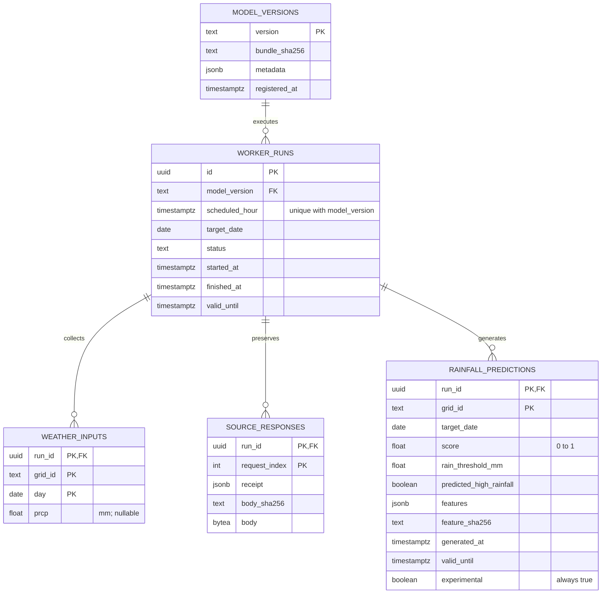
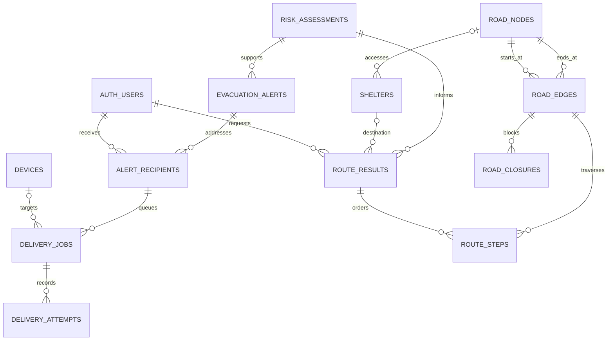
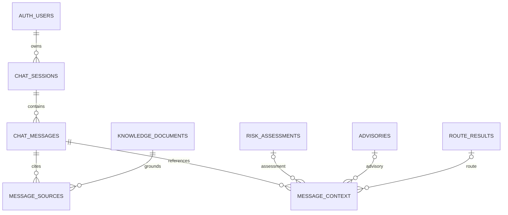

# FloodSafe database design

Issue #6 · Design baseline: 9 November 2026.

This document defines the implemented application/worker records and the logical
design for remaining features. **Proposed tables below are not created or deployed.**
Their implementation belongs to #10, #14, #15 and #17–#19. Existing SQL migrations
are authoritative; completing this design does not change the hosted database.

## Choice and common rules

Supabase PostgreSQL keeps Auth identities, application records and durable worker
history in one transactional database. PostGIS in `extensions` supplies indexed
polygon matching and metre-based distance operations. Foreign keys, check/unique
constraints and RLS enforce relationships and ownership independently of Flutter.
The existing free-tier setup therefore needs no separate spatial database.

Geography points use SRID 4326 and longitude/latitude order. Zone boundaries are
valid, nonempty MultiPolygons. `ST_Covers` includes boundary points; real GPS must
exclude demo zones. Overlapping active assessments select highest severity then
newest issue time. Missing/expired evidence never implies low risk. GiST indexes
support spatial queries; they do not supply a road graph or hazard model.

Instants use UTC `timestamptz`; explicit daily weather targets use `date`. Source
issue, retrieval, processing and validity times are separate. Proposed UUID IDs
use `gen_random_uuid()`; all FKs need indexed retrieval paths. New schema changes
require reviewed migrations, explicit grants/RLS, isolated database checks and
rollback scripts. Applied migrations must not be edited.

## Implemented application records

The [core ERD](../supabase/README.md#current-erd) and
[migrations](../supabase/migrations) specify deployed relationships.

| Record | Keys, constraints and timestamps | Access / lifecycle |
| --- | --- | --- |
| `auth.users` | Supabase-managed UUID identity | Auth service; never duplicate passwords/OTPs |
| `profiles` | PK/FK user_id; en/sw; notification preferences; location_consent_at, created_at | Owner RLS; user deletion cascades |
| `saved_places` | UUID PK; user/place FKs; point or place required; unique user/place; partial unique index permits one default; created_at | Owner RLS; set_default_place serialises per-user changes; catalogue saves do not collect GPS |
| `user_location_telemetry` | UUID PK; user FK; geography point; finite nonnegative accuracy; recorded_at, received_at | Schema only; no ingestion/client grants or pruning job |
| `devices` | UUID PK; user FK; unique push token; android/web/ios; enabled; updated_at | Schema only; token registration/delivery not implemented |
| `places` | Text PK matching Flutter catalogue; demo/publication flags; created_at | Published backend and authenticated catalogue reads |
| `susceptibility_grid` | UUID PK; checked MultiPolygon; source; demo/publication flags | Published backend reads; no fabricated live GPS zones |
| `risk_assessments` | UUID PK; optional place/zone FKs, at least one required; low/moderate/high; source/model version; issued_at, valid_until, created_at; expiry after issue | Published backend reads; distinct from experimental rainfall scores |
| `rainfall_telemetry` | UUID PK; geography; finite nonnegative mm; forecast/observation/reanalysis; unique source/source_record_id; valid_at, retrieved_at | Schema only; worker uses separate private history |
| `advisories` | UUID PK; optional place FK; en/sw; HTTPS source; published_at, valid_until; positive validity | Published backend reads; app checks freshness |
| `assistant_answers` | Composite PK id/language; question/answer/category/order; source URL; reviewed_at, valid_until | Backend sees published, current answers; no stored conversations |

User deletion cascades to profiles, saved places, telemetry and devices. Place
deletion cascades to saved catalogue links. Other core references retain their
migration-defined deletion restrictions; dependent risk/advisory records need
deliberate handling before deleting their source place or zone.

## Implemented private worker ERD

All five tables are in `floodsafe_pipeline`, outside the exposed public Data API.
A weather `grid_id` is a provider cell identifier, **not** a foreign key to
`susceptibility_grid.id`; future hazard integration must justify their association.

Bundle/source/feature hashes preserve provenance. Model/hour uniqueness and an
advisory lock prevent competing jobs. Child records cascade on deliberate run
pruning; referenced model versions cannot be deleted. Partial writes roll back.
Scores expire within two hours and at UTC day end. `latest_status` and
`current_predictions` expose only bounded status/current results; failed,
incomplete or running latest attempts hide older successes. Expiry suppresses
display but does not delete history. No worker score automatically becomes a
public flood-risk assessment.

## Proposed routing and alert ERD — not created

| Proposed record | Keys / required constraints / timestamps |
| --- | --- |
| `evacuation_alerts` | UUID PK; assessment FK; unique event key including assessment version and policy; draft/active/cancelled/expired; en/sw content, source; issued_at, valid_until, created_at; expiry after issue |
| `alert_recipients` | UUID PK; alert/user FKs; unique alert/user; matched zone FK; consent/policy snapshot; matched_at, created_at, read_at |
| `delivery_jobs` | UUID PK; recipient FK; nullable device FK for push; push/SMS channel; server-only destination reference; unique recipient/channel/destination key; pending/processing/retry/succeeded/failed/cancelled; bounded retries; next_attempt_at, created_at, updated_at |
| `delivery_attempts` | UUID PK; job FK; unique job/attempt number; safe provider ID/error code; unique provider callback event for idempotence; started_at, accepted_at, delivered_at, failed_at; acceptance is distinct from confirmed delivery |
| `road_nodes` | UUID PK; unique source/node/version; geography point; source/licence; imported_at, updated_at |
| `road_edges` | UUID PK; from/to node FKs; direction; finite nonnegative length/base-cost/risk-weight; network version/source; imported_at, updated_at; index from-node/version |
| `road_closures` | UUID PK; edge FK; blocked flag/source; issued_at, reviewed_at, valid_until; positive validity; stale evidence cannot establish an open road |
| `shelters` | UUID PK; nullable access-node FK; geography; accessibility/capacity metadata; authoritative source; verified_at, valid_until, created_at, updated_at; current reviewed destinations only |
| `route_results` | UUID PK; owner/assessment FKs; nullable destination FK for no-route; network/policy versions; origin geography; available/no-route/unavailable/stale; finite nonnegative cost; computed_at, valid_until capped by dependent evidence |
| `route_steps` | Composite PK route/sequence; route/edge FKs; direction, nonnegative cost; cascade on route deletion |

Road networks are directed; reverse travel needs an allowed reverse edge. Dijkstra
requires nonnegative weights. Exclude known blocked roads and explicitly handle
disconnected graphs. Missing/stale hazards or destinations produce unavailable
guidance, not a “safe route”. Retain the exact network/risk/policy versions used.
No verified road graph, shelter catalogue or live closure feed exists yet.

Planned indexes: GiST on points; assessment zone/validity; closures edge/validity;
recipient user/created time; partial queue state/next-attempt index; unique
attempt job/number and provider callback keys. Index child FKs where composite PK
prefixes do not already cover retrieval. Validate consent and zone membership
before creating a unique event/user recipient; retries must reuse the same job.

## Proposed assistant ERD — not created

The current guided question catalogue needs no conversation storage or paid LLM.
Introduce these records only if retained sessions/context become required.

| Proposed record | Keys / constraints / timestamps |
| --- | --- |
| `knowledge_documents` | UUID PK; unique source/version/language; en/sw; source URL/content hash; reviewed_at, published_at, valid_until; reviewed current material only |
| `chat_sessions` | UUID PK; owner FK; language; created_at, last_active_at, expires_at; user deletion cascades |
| `chat_messages` | UUID PK; session FK; unique session/request ID for retry deduplication; user/assistant role; bounded text or catalogue question ID; created_at; no credentials or precise GPS in prompts |
| `message_sources` | Composite PK message/document; FKs; source version retained; citation review timestamp |
| `message_context` | UUID PK; message FK; optional assessment/advisory/route FKs, exactly one non-null; captured_at, source_issued_at, source_valid_until |

Context retrieval checks owner authorisation and freshness; absent routes or
expired risk are reported as unavailable. Session/source indexes support bounded
retrieval. Public guided help remains usable without storing guest conversations.

## Access, retention and deletion design

Every new table requires explicit grants and RLS; automatic Data API exposure
stays off. `auth.uid()` determines owner identity, never a request user ID. JWT
validation and feature-specific permissions remain implementation work. The
restricted worker cannot read app profiles; backend readers cannot read raw
worker evidence. Administrative credentials stay outside Flutter and Git.

| Records | Access | Retention design |
| --- | --- | --- |
| Profiles / saved places | Owner only | Until owner removal/account deletion; implemented cascades |
| Location telemetry | Explicit-consent server ingestion, owner-authorised reads | Proposed maximum 24 hours; current foreground GPS remains transient |
| Device tokens | Authenticated registration; delivery service minimum access | Remove invalid tokens promptly; expire after 90 inactive days |
| Weather / raw evidence / predictions | Private worker; backend bounded views only | Proposed 90 days; prune whole runs atomically; retain model/research provenance while referenced |
| Published geography / knowledge | Reviewer writes; filtered public reads | Version while referenced; withdraw expired material from current retrieval |
| Route origins / results | Owner and routing service | Proposed maximum 24 hours; cascade steps; aggregate evaluation without coordinates |
| Alert recipients / jobs / attempts | Owner sees own alert; delivery service sees destination minimum | Proposed 90 days after expiry; remove identifying destinations/tokens on account deletion; anonymous aggregate metrics only afterward |
| Sessions / messages / context | Owner and constrained assistant service | Proposed 30 days; owner deletion; cascade messages, citations and context |

These are engineering defaults, not deployed pruning jobs or statutory retention
claims. Before collecting each new data class, implement pruning, deletion and
ownership tests. Future user FKs cascade to recipients/sessions/routes; dependent
jobs, attempts, steps, citations and context cascade down their parent chains.
Risk/source/road/destination references use restricted deletion or nullable
references where allowed; prune dependent operational rows first. Identifying JSON
snapshots must not survive parent identity deletion. Avoid storing phone/SMS
destinations until the consent and verified-contact workflow exists.

## Completion boundary

Database choice, ERDs, keys, spatial/time constraints, access and retention design
complete #6's design deliverables. New routing/delivery/chat tables remain future
feature migrations; speculative tables are not deployed today. #8 covers endpoint
contracts, #9 experimental weather/inference, and #13 app integration. The separate
Chapter 5 report remains an implementation snapshot, not evidence that planned
features or retention jobs already work.
