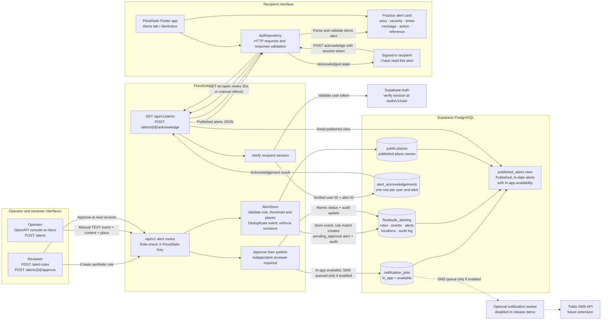

# FloodSafe alert demo architecture

This diagram traces the implemented controlled TEST-alert demonstration from
operator entry to the recipient-facing Flutter inbox. It covers the alert
workflow, not the separate rainfall, place-search or route-planning features.

## Component responsibilities

| Component | Responsibility in the demo |
| --- | --- |
| Operator OpenAPI console | Lets the operator submit a controlled manual event and lets a reviewer define the synthetic rule. The console is served by FastAPI at `/docs`; it is not a separate admin website. |
| FastAPI alert routes and role checks | Expose the operator, reviewer and recipient endpoints. Operator/reviewer actions require role-specific `X-FloodSafe-Key` credentials. |
| `AlertStore` | Applies rule matching, validates published place IDs, makes event ingestion idempotent, and performs revision-checked alert transitions. |
| Supabase PostgreSQL | Persists rules, source events, alert state, locations, audit records, the in-app availability row and per-user acknowledgements. The `published_alerts` view returns only published, currently valid alerts with an available in-app notification and published locations. |
| Flutter `AlertInbox` and `ApiRepository` | Poll the API while the Alerts tab is open, allow manual refresh, validate returned test-alert fields and display a “Practice alert” card with location, severity, times, reference, message and action. The API response must have `is_demo=true`; expired alerts are filtered from display. |
| Supabase Auth | Supplies the recipient session used for acknowledgement. The backend verifies the bearer token with Supabase Auth before saving the verified user ID; sign-in is not required just to view the inbox. |
| Optional SMS worker | Future extension only. SMS sending is disabled and is not part of this release demonstration. |

## Demo flow and important design decision

1. A reviewer creates a synthetic rule. An operator submits a `manual_report`
   event marked as a controlled TEST, with a matching rule and published place.
2. The API records the event and creates an alert in `pending_approval`. A
   different reviewer must approve it; the creator cannot approve their own
   alert.
3. An operator or reviewer publishes the approved alert. Publication checks the
   expected revision and, in one database transaction, updates the alert/audit
   state and creates an available `in_app` notification row.
4. The open Flutter inbox polls `GET /api/v1/alerts` every 30 seconds. The API
   reads the database view, and the app renders the returned practice alert.
5. A signed-in recipient may acknowledge it. The API verifies the Supabase
   session and stores a unique acknowledgement for that user and alert.

**Demo-critical decision:** publication and creation of the in-app availability
row are transactional. The inbox view requires both a published, in-date alert
and that row, so a partially published alert is not exposed to Flutter. The
independent-review step also prevents an operator's unapproved test event from
appearing in the public inbox.

**Demo dependency and boundary:** the Flutter build must point
`FLOODSAFE_API_URL` at a running API connected to the alert database, and the
API must have `FLOODSAFE_ALLOW_DEMO_DATA=true` or its public query will hide
TEST alerts. Supabase Auth configuration is additionally needed to acknowledge
an alert, but not to view it. This workflow creates manual TEST events; it does
not consume a live flood sensor or a calibrated flood-risk model and must not
be presented as a real public warning. The inbox currently labels the card
“Practice alert”; the API separately validates the `is_demo` marker.
