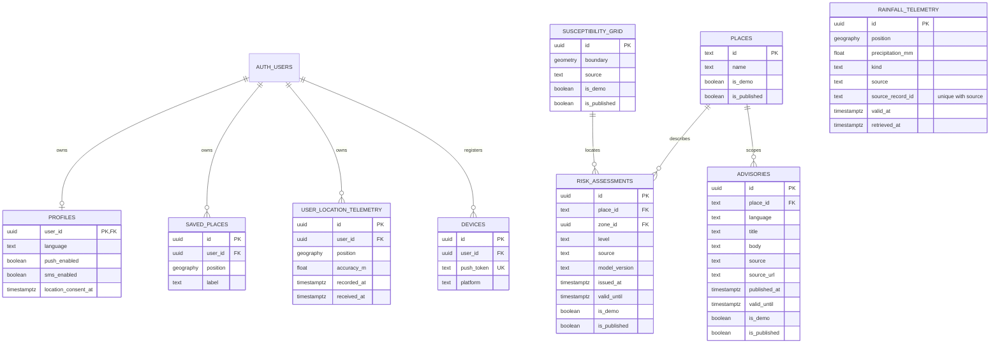

# Database design and migration plan

Supports M2 issues #6 (spatial schema), #7 (migrations/seeds), public-read portions of #8 (APIs), and Flutter #13. Backend setup is in [backend/README.md](../backend/README.md). Full authentication, telemetry ingestion, operational model execution and queued alerts are later work.

## Current ERD

Place IDs match the Flutter contract; assessment and advisory IDs are UUIDs. Nullable advisory place means general guidance. An assessment needs a named place, a spatial cell, or both. Static geographic boundaries and time-bound risk outputs are separate; no simulated-discharge label is treated as verified flooding.

## Spatial and time rules

PostGIS lives in `extensions`, using SRID 4326. Points use geography for later metre-based distance queries; polygons use valid, nonempty MultiPolygon geometry. Longitude is the X coordinate. GiST indexes support spatial lookup; user/time, rainfall/time, risk/place/time and advisory/place/language/time indexes support current retrieval.

`ST_Covers` includes polygon boundaries. Invalid/out-of-range request coordinates are rejected before database calls. Real GPS never matches demo polygons, even when named demo places are enabled. With overlapping active polygons, choose the highest risk, then the newest issue time. If no active polygon assessment exists, an expired matching assessment can produce a stale state; no match is unavailable, not low risk. Published flags and validity are independent.

## Access control

All nine core application tables explicitly enable RLS in migration SQL, independently of the dashboard's automatic-RLS setting. Migration `202610280002_guided_assistant` adds a tenth table, `assistant_answers`, with RLS restricting backend reads to published, currently valid answers. Anonymous direct Data API access is not granted. `authenticated` can manage only its own profile and saved places using `auth.uid()`; user identity is not accepted from arbitrary request bodies. Other private tables have no direct client grants yet.

The API switches every transaction to `floodsafe_reader`, a non-login/non-BYPASSRLS role with SELECT only on published places, grid cells, risk assessments and advisories. API transactions are read-only and bounded by statement timeouts. Migration administration credentials are never bundled in Flutter. The API has no publishing endpoint. A separate least-privilege database login can replace the initial administrative session-pooler login later without changing the public API.

Automatic table exposure stays OFF. New grants, policies and service capabilities must be explicit migrations. A Supabase service-role key bypasses RLS and is not needed for this increment.

## Seeds, migrations and rollback

`202610280001_core.sql` creates the schema. The migration runner uses one transaction, an advisory lock and a private checksum ledger. Never edit a migration after it has been applied to a shared environment; add a new one.

`seed.sql` is opt-in development data: four named sample places, three labelled risk scenarios and one example advisory. No polygons are seeded, so GPS cannot be assigned a fabricated risk. Re-running seeds preserves original issue/expiry times; it does not rejuvenate stale data. No user accounts, telephone numbers, device tokens or coordinates are seeded.

PostGIS must be in the `extensions` schema. If an existing installation lives elsewhere, the migration stops; review/migrate the existing extension instead of silently relocating it.

A destructive rollback script is provided in `rollbacks/202610280001_core.sql`. Back up first and use it only when this is the last applied migration and dependencies are understood. It drops this increment's application tables and their data, not `auth.users`, PostGIS, the reader role or unrelated tables. Remove its ledger entry only in the same rollback transaction after successful rollback. Rollback/reapply is tested only in the isolated disposable database; never run database tests against Supabase.

## Planned later entities (not created)

| Component | Proposed records and relationships |
| --- | --- |
| Alerts (#10/#15) | `evacuation_alerts` → assessment; `alert_recipients` → alert/user; unique event/user key to prevent duplicates |
| Delivery (#10) | `delivery_jobs` and `delivery_attempts` → recipient/device; channel, retries, provider ID, acceptance/delivery/acknowledgement timestamps |
| Routing (#14) | `shelters` with verification dates; `road_nodes` and nonnegative weighted `road_edges`; closures; versioned `route_results` linked to risk-data versions |
| Chat (#16–#20) | `knowledge_documents` with sources/review dates; owner-private `chat_sessions` and `chat_messages`; assistant context references to authorised advisory/risk/route records |

## Retention design for later ingestion

No location/device/phone data is collected by this increment. GPS is transient API input and not written to the database. Before enabling telemetry, implement an explicit-consent collection policy, deletion job, authentication and ownership tests.

Initial proposals to review: location telemetry expires within 24 hours; saved places remain until deletion/account removal; invalid push tokens are removed and inactive devices expire after 90 days; operational rainfall/risk records retain 90 days with research archives kept separately; chat messages default to 30 days with user deletion. Alert/delivery audit retention must be agreed before those tables are created. Retention jobs are not implemented, and these are not claims about statutory retention requirements.

`auth.users` deletion cascades to profiles, saved places, telemetry and devices through foreign keys. Do not duplicate authentication passwords or OTPs in application tables.

## Cost boundary and remaining work

Use Supabase Free and local Python hosting. There is no paid SMS, live AI, automatic weather ingestion, inference schedule or production deployment in this change. Database capacity, backups, hosting uptime and external-service quotas need review before a live pilot. Real Supabase login/JWT integration, bilingual reviewed advisories, delivery and model contracts remain open; do not close the parent GitHub issues based on public-read integration alone.
